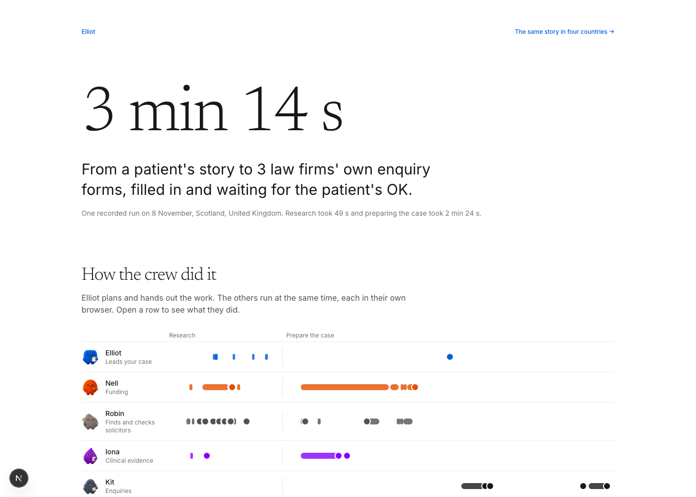
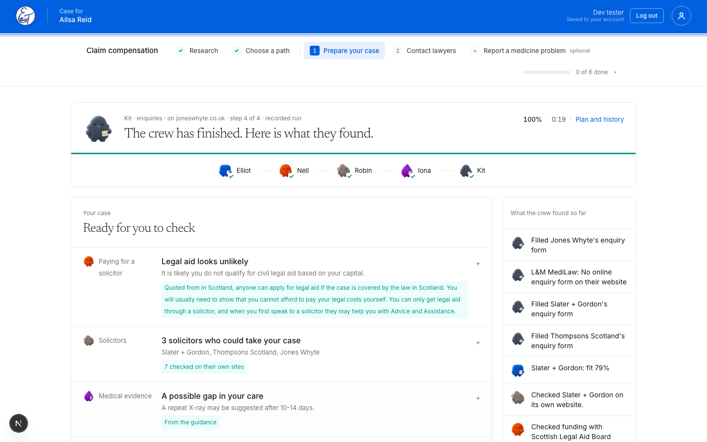
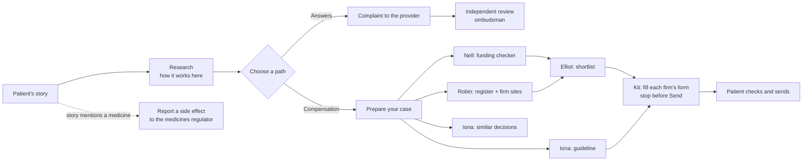

# Elliot

**A crew of browser agents that helps a patient after medical negligence, wherever they live.**

A patient tells Elliot what happened in their own words. A crew of five AI agents then works the real web for them, live and in parallel. They work out how complaints, compensation and legal aid work in that patient's country, run the official eligibility checker, search the professional register, check each law firm on its own website, find the clinical guideline that applies, and fill in each firm's own enquiry form. Then they stop before Send, so the patient has the final word.

Built in 24 hours at HackTheBurgh 2026 for the Wordsmith.AI challenge: *"Make the most complicated end-to-end agentic AI browser-use workflow."*



## One journey, end to end

Our demo patient is Ailsa Reid, a fictional patient in Edinburgh. A&E called her broken wrist (a scaphoid fracture) a sprain. Here is one recorded run from her story to her case:

| | |
|---|---|
| **Time** | 3 min 14 s in total: research 49 s, preparing the case 2 min 24 s |
| **Web** | 34 pages read across 26 sites, 13 searches, 10 pages that needed a real browser |
| **Teamwork** | 113 hand-offs between the five agents, several browsers working at the same time |
| **Patient's input** | 4 questions, asked in the checker's own words, only when the answer was not already known |
| **Result** | Legal aid estimate from the Scottish Legal Aid Board's own checker, 7 law firms checked on their own sites, a clinical guideline quoted word for word, and 3 firms' own enquiry forms filled and waiting for the patient's OK |
| **Cost** | about $0.68 at list prices, with the patient's health, money and identity read by a model on the laptop itself |

Every number here is counted from the run's own logs, which the `/insights` page reads and replays.



## The crew

| Agent | Job | In the browser |
|---|---|---|
| **Elliot** | Leads. Plans the work, hands it out, re-plans when something changes, writes the summary | (plans only) |
| **Nell** | Funding | Answers the place's own legal aid or funding checker, page by page |
| **Robin** | Research and law firms | Reads official pages, searches the professional register with its own filters, checks each firm on its own website |
| **Iona** | Clinical evidence | Finds the clinical guideline for the injury, quotes it, and looks for published decisions in similar cases |
| **Kit** | Forms | Finds each firm's enquiry form, fills it in, and stops before Send |

The agents run in parallel, each in its own browser tab, and you can watch every tab live inside the app.

## The workflow



1. **Research.** The crew works out, live, how the system works for this patient's place: where to complain, the independent body, compensation, legal aid, time limits, clinical guidance, free help and records. Every fact is a quote that code finds on the page it came from.
2. **Choose a path.** Elliot recommends a track and explains why: answers and an apology, or compensation.
3. **Prepare your case.** The crew works in parallel:
   - Nell answers the official funding checker.
   - Robin searches the register and checks each firm on its own site.
   - Iona finds the guideline and similar decisions.
   - Elliot shortlists three firms.
   - Kit fills each firm's own form.
4. **Contact lawyers.** The patient reviews every filled form, can edit any field, ticks the consent boxes they agree to, and sends.
5. **Report a medicine problem (optional).** If the story involves a medicine, the crew finds the country's own medicines regulator, reads the medicine and the side effect from the story, and fills the regulator's report form. In the UK that is the MHRA's Yellow Card.

**Each place's system is discovered live.** The same crew finds each place's own bodies, checkers, registers and forms through search and page exploration. `/compare` runs the same story in Edinburgh, Dublin, Auckland and San Francisco side by side.

## How browser use made this possible

None of this has an API. The checker, the register, the firms' sites and their forms only exist as web pages built for people, so the crew uses them the way a careful person would:

- **Real eligibility checkers.** Nell steps through the official checker one page at a time. Each answer changes the next question, and she reads the final estimate word for word.
- **Real search forms.** Robin uses the register's own search form: dropdowns, autocomplete boxes, filters, "load more" and detail pages.
- **Unfamiliar sites.** Kit finds the right form on sites it has never seen: contact pages, pop-ups, embedded form tools, forms that only load on scroll, multi-page forms with conditional questions. Newsletter sign-ups are told apart from real enquiry forms.
- **Fetch first, browser when it matters.** Most official pages are read with a plain request in a fraction of a second. A real browser opens only when a page needs one: a script-built page, a bot check, a checker, a register search or a form. Every page and the reason it needed a browser is logged.
- **Recovery.** When a register is blocked or a firm has no online form, the crew finds another route: another directory, the next best firm, the site's own search.

## Safe by design

- **Never sends.** The agents stop before every final Submit or Send. Code, not the prompt, decides what may be pressed, including JavaScript "Continue" buttons that would secretly send a form.
- **Asks, never guesses.** Missing personal answers are asked of the patient in the site's own words. Consent boxes stay unticked until the patient agrees.
- **Private by routing.** The steps that write or reason over the patient's health story, money or identity run on a model on the patient's own machine (Qwen3 8B through Ollama), chosen in code by `modelFor()`. These include her letters and enquiry message, comparing her care with the guideline, and reading the medicine from her story. When Kit fills a firm's enquiry form, the form model sees field names and descriptions, never the values typed into them.
- **Quoted, not invented.** Facts come with a quote that code checks against the page text, plus a link.

## Models

| Model | Job | Why |
|---|---|---|
| `gpt-5.4` | Elliot's planning, re-planning and writing | Used where a wrong call costs the most |
| `gpt-5.4-mini` | Reading pages, choosing links, research loops | Many calls per run, so it must be quick and cheap |
| `gpt-6-luna` (OpenAI Decisions API) | Yes, no or pick-one answers with a confidence, and choosing form fields | The model only chooses; code does the typing |
| `qwen3:8b` (local, Ollama) | Writing and reasoning over health, money or identity: letters, the enquiry message, the care comparison, the medicine report | Those steps run on the patient's own machine |

Every call is written to a model ledger: which agent, which model, tokens in and out, time, and what kind of data it saw. `/insights` turns this into the cost and token figures.

## Run it

```bash
npm install
npx playwright install chromium
cp .env.example .env.local      # add OPENAI_API_KEY and LINKUP_API_KEY
ollama pull qwen3:8b            # the local model for private data (Ollama running)
npm run dev                     # http://localhost:3000
```

Optional:
- **Accounts:** Auth0 for sign-in, and Tiger Data (Postgres) to save the case to your account. Fill the `AUTH0_*` and `DATABASE_URL` values to turn them on.

**No keys?** Recorded runs ship in `demo/`. On any running step, **Use the recorded run** plays a real recorded run, browsers and all, in about 20 seconds. `/compare` plays four countries at once.

## Pages

| Page | What it shows |
|---|---|
| `/` | Home |
| `/start` | Onboarding: the patient tells their story |
| `/case` | The case: research, the chosen path, each step's crew working live, the case file |
| `/insights` | One recorded journey told as a story: the crew on one clock, the models, the cost, the filled forms |
| `/compare` | The same story in four countries, side by side |

## Code map

| Where | What |
|---|---|
| `lib/agent/crewRun.ts` | The crew runtime: planner turns, parallel lanes, background jobs, questions to the patient, skips |
| `lib/agent/discovery.ts` | Research: how the system works in this place |
| `lib/agent/compensationAnywhere.ts` | Prepare your case: funding, firms, evidence, shortlist, enquiry forms |
| `lib/agent/complaintAnywhere.ts`, `escalationAnywhere.ts`, `medicineReport.ts` | The complaint, the independent review and the medicine report |
| `lib/agent/workers/` | Site-agnostic browser workers: `explore` (read and navigate any site), `fillForm`, `questionnaire` (checkers), `searchDirectory` (registers), `quickRead` (fetch first) |
| `lib/agent/decisionAgent.ts`, `pressGuard.ts` | Form filling with the Decisions API, and the code that decides what may be pressed |
| `lib/agent/ledger.ts`, `access.ts` | The model ledger and the web access log |
| `lib/liveview.ts`, `app/LiveView.tsx` | Live view of every agent's browser tab inside the app (CDP screencast) |
| `lib/agent/runRegistry.ts` | Runs live on the server and survive reloads and navigation |
| `scripts/` | Headless end-to-end runs (`e2e-case.ts`), safety suites (`test-send-trap.ts`, `test-fill-form.ts`, `test-worker-safety.ts`) and UI checks |

More detail: [docs/ARCHITECTURE.md](docs/ARCHITECTURE.md) explains how it works, and [docs/WORKFLOW.md](docs/WORKFLOW.md) walks through Ailsa's case step by step.

## Stack

Next.js 16 (App Router) · TypeScript · Playwright (Chromium) · OpenAI (`gpt-5.4`, `gpt-5.4-mini`, Decisions API `gpt-6-luna`) · Ollama (`qwen3:8b`) · Linkup search API · Auth0 · Tiger Data (Postgres) · Tailwind CSS v4

All patients in this repo are fictional. Nothing is ever sent: every form is filled and stopped before Send.
